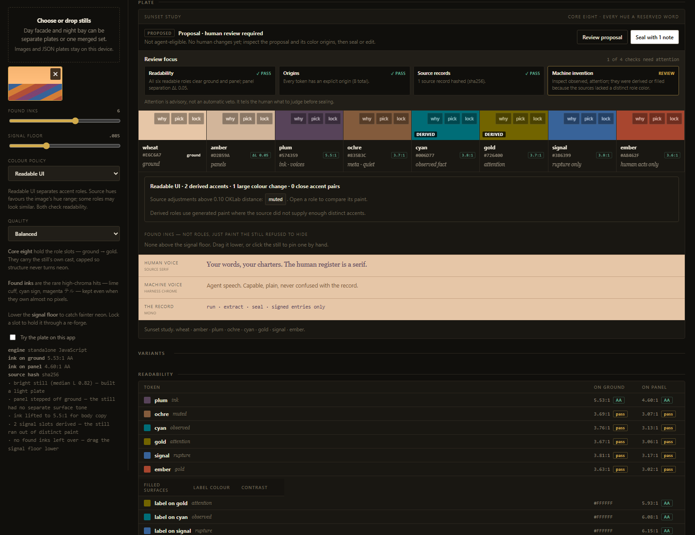
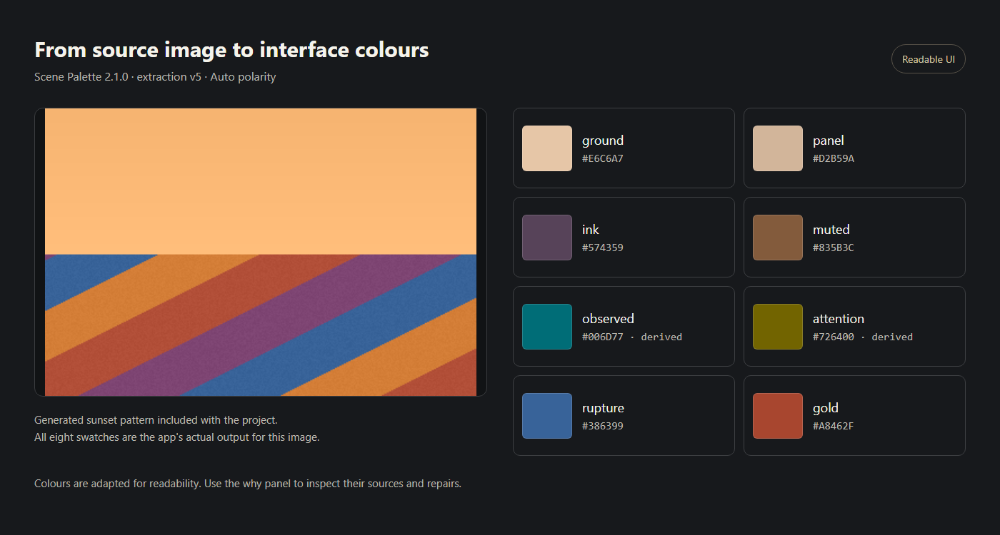

# Scene Palette

**[Try Scene Palette Online (Beta)](https://mythicruntime-lab.github.io/scene-palette/)**

Extract color palettes from images, preview them in an interface, and export them. Free, offline-capable, and no installation required.

Turn an image into a readable colour palette for interfaces, websites, and Godot projects.
Drop in a photograph, illustration, or screenshot, then preview and export the result.

Scene Palette runs locally. Open the standalone HTML file with **no installation**, or use
the Go app for a local browser interface and command-line tools. Both engines use the same
palette format and have exact parity checks for identical working pixels.



## Quick start — no installation

1. On this repository's GitHub page, choose **Code → Download ZIP**.
2. Extract the ZIP, then open **`index.html`** in a current desktop browser.
3. Click **Try a sample** for the blue example, select another sample thumbnail, or drop your own image and click **Forge plate**.

The standalone app works offline and needs no Go, Node.js, or web server. Images are processed
on your device.

## Make your first palette

1. Add one image, or up to eight images to combine their colours. PNG and JPEG are good starting points.
2. Leave polarity on **Auto** and colour policy on **Readable UI**, then click **Forge plate**.
   A *plate* has eight roles: `ground`, `panel`, `ink`, `muted`, `observed`, `attention`, `rupture`, and `gold`.
3. Check the previews and **Readability** matrix. Try **Dark** or **Light** for another background
   style, or **Remix** for another available accent combination.
4. Open a role's **why** details to compare its recorded source and current paint. **Use source colour**
   restores that paint and locks the role; **pick** lets you sample a colour from the image instead.
5. Click **Save** to keep the plate on the shelf. Choose an **Export** format, then **Download**.

Use **Export shelf** to back up saved plates. Browser storage can be cleared or unavailable,
especially for local files; retain an exported copy of work you care about.



## Choose how colours are adapted

| Colour policy | Best fit |
| --- | --- |
| **Readable UI** (default) | Readable semantic roles with distinct accents. It can derive colours when the source lacks enough distinct paint, then rechecks distinction after repairs and locks. |
| **Source hues** | A palette closer to the image's hue range. It keeps all eight roles and reuses source hues or neutral tones on sparse images instead of adding arbitrary accent hues. Some roles may look similar. |

Both modes target **4.5:1 contrast** for generated body ink and **3:1** for muted text and accents
on both surfaces. Locks remain exact, even when they fail. Raw **found inks** retain source paint.
Read the warnings for similar accents, large adjustments, or source hues shifted for readability.
Forcing the opposite polarity can change colours substantially; the final interface still needs review.

## Export formats

| Format | Use it for |
| --- | --- |
| **CSS** | Custom properties for a website or interface. |
| **Godot 4 pack** | A GDScript colour resource for a Godot project. |
| **JSON** | Reopening a palette with roles, metadata, and colour origins intact. |
| **GPL** | A palette for compatible art tools such as GIMP, Aseprite, or Krita. |
| **HEX** | A plain list of colour values. |
| **Bundle** | A ZIP with the palette, exports, swatch preview, and available source images. |

The [user guide](docs/USER_GUIDE.md) covers comparison, theme pairs, shelves, and vault exports.
Older valid palettes keep their recorded metadata and seals when opened; only an explicit
re-forge uses the current extraction algorithm.

## Windows app

Download the [Windows x64 beta](https://github.com/mythicruntime-lab/scene-palette/releases/tag/v2.1.0-beta.2) and choose the installer or
portable ZIP. SHA-256 checksums are provided on the release page.

If you have a portable Windows ZIP, extract it and double-click **`scene-palette.exe`** or
**`Run Scene Palette.cmd`**. It opens in your default browser. Keep its console window open
while you work; close it to stop the server. The package needs no Go installation and includes
the standalone HTML file.

If you have the Windows **Setup.exe**, run it to install Scene Palette for your user
account, then launch it from the Start Menu. The desktop shortcut is optional. Close
Scene Palette's console before upgrading or uninstalling. Uninstall through Windows
Apps; exported palettes and browser storage are preserved.
Back up important work with **Export shelf**. Portable and installed copies share the
same browser shelf only when you use the same browser profile and local address.

Both Windows packages are unsigned. The installer and ZIP are separate from GitHub's
source download.

**GitHub's Code → Download ZIP contains source files, not a Windows executable.** A hosted
Windows Release is not provided by that download. Use the release link above, open the HTML
file, or build the ZIP below.

### Build the Windows ZIP

With a current patched Go toolchain and Git on your `PATH`, run in PowerShell:

```powershell
git clone https://github.com/mythicruntime-lab/scene-palette.git
cd scene-palette
powershell -NoProfile -File scripts/package-windows.ps1
```

The unsigned ZIP and checksums appear in `bin/releases/`. The package includes the executable,
HTML, launcher, usage notes, licenses, and build information. See
[Contributing](CONTRIBUTING.md) for toolchain verification, clean release-build checks,
and creating the installer from the same verified portable folder.

## Run from source

The source supports **Go 1.23 or newer**; use a currently supported, patched version for
distribution. Open a terminal in the repository:

```sh
go run . serve -open
```

Keep the terminal open while using the loopback app, usually at `http://127.0.0.1:8765/`;
press **Ctrl+C** to stop. There is no frontend build step or npm install required to run it.

For command-line extraction:

```sh
go run . forge -out palette.json -name "Night bay" "path/to/image.png"
go run . forge -color-policy source-hues -out source-palette.json "path/to/image.png"
```

See the [command reference](docs/USER_GUIDE.md#command-line-reference) for bundles, polarity,
and palette verification.

## Documentation and development

| Document | Contents |
| --- | --- |
| [Changelog](CHANGELOG.md) | Version history and notable changes. |
| [User guide](docs/USER_GUIDE.md) | Controls, extraction, themes, shelves, bundles, and the CLI. |
| [Contributing](CONTRIBUTING.md) | Development setup and Go, JavaScript, parity, and browser tests. |
| [Quality report](docs/QUALITY_REPORT.md) | Test results, coverage, and known limitations. |
| [Go architecture](docs/GO_MIGRATION.md) | Engine boundaries, local API, and durable file contract. |
| [Security](SECURITY.md) | Import safeguards, privacy, vulnerability reporting, and secret scanning. |

Generated test patterns support repeatable regression and Go/HTML parity checks. The quality
report distinguishes those checks from real-image evaluation; patterns alone do not establish visual quality.

## License

Code, documentation, and generated test patterns use the [MIT License](LICENSE). Bundled and
adapted components retain the notices in [THIRD_PARTY_NOTICES.md](THIRD_PARTY_NOTICES.md).
Images you supply remain subject to their owners' terms.
