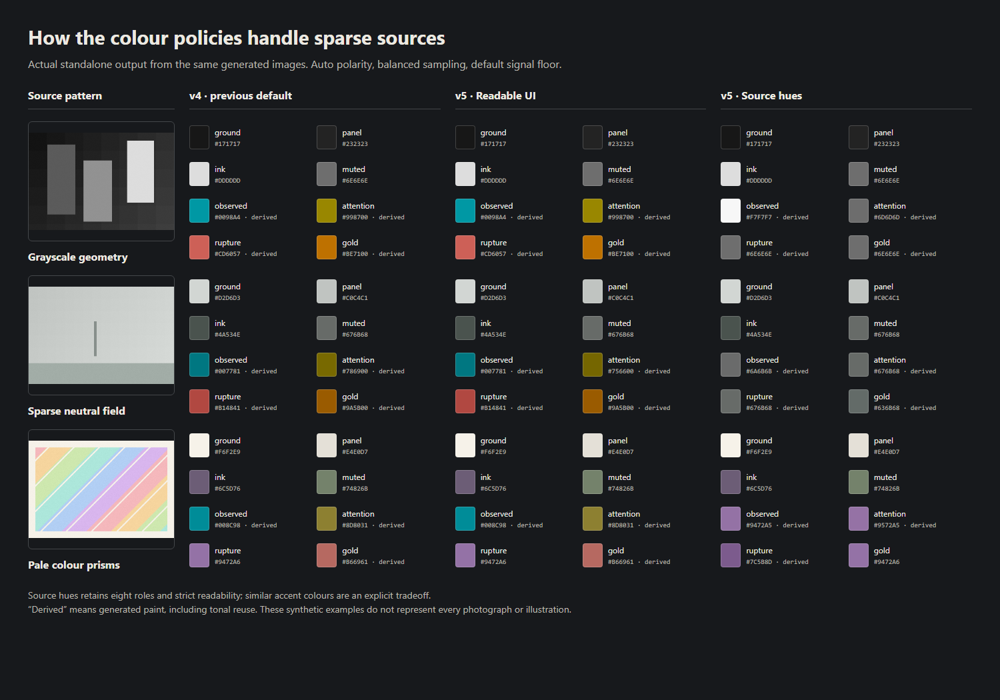

# Palette quality and validation — 2026-10-26

This report covers application **2.1.0 / extraction v5**, checked locally on Windows
with Go 1.27.3, Node 24.11.1, and headless Edge. It separates generated regression
patterns from the same twenty real images used in the earlier evaluation. Fresh
browser profiles and visual review are not a recruited-user study or a universal
measure of visual quality.

## Current results

| Local corpus | Policy | Exact Go/HTML comparisons | Generated readability failures | Final accent distinction |
| --- | --- | ---: | ---: | --- |
| Ten generated patterns + pooling | Readable UI | 238 | 0 | All eligible pairs pass |
| Ten generated patterns + pooling | Source hues | 238 | 0 | Similarity is reported; no distinction gate |
| Twenty original public examples + pooling | Readable UI | 503 | 0 | All eligible pairs pass |
| Twenty original public examples + pooling | Source hues | 509 | 0 | Similarity is reported; no distinction gate |

All four runs had **zero snapshot mismatches, zero execution errors, and zero locked
or manual core-token exclusions from readability**. Readable UI had zero excluded
accent pairs. Source hues intentionally excludes its pairs from the distinction
gate; this is not recorded as a distinction pass. Its real-image run recorded 240
close-pair observations across both engines and all settings, including repeated
variants of the same image.

The full browser suite passed **43 checks**, with zero unexpected browser
errors. It exercises hostile shelf import/restore in served and standalone modes,
valid legacy seals, transient found-ink IDs, policy persistence, source-paint restore
and Undo, delayed-response races, picking/locking, save/reload, comparisons, exports,
bundles, vaults, and both engines. Deliberately invalid imports produce two expected
validation errors, asserted separately from unexpected errors.

The full Go suite and vet, actual-HTML image/histogram goldens, JavaScript colour-math
and contract checks, and deterministic PNG generation also pass. The CI workflow is
prepared for Windows/Linux and supported Go families, with a separate minimum-Go
compatibility job. These are **local verification results**, not evidence of successful
GitHub Actions, Linux, or minimum-Go jobs. Consult the repository's Actions runs for
remote CI status after a push.

## What changed in the colour output

The comparison below uses the default Auto plate for each of the same twenty images,
with the same sampling and signal settings. Distances are Euclidean OKLab, not
CIEDE2000. A distance threshold is not proof of accessibility or colour-vision safety.

| Diagnostic | v4 default | v5 Readable UI | v5 Source hues |
| --- | ---: | ---: | ---: |
| Images with a close accent pair below 0.07 | 3 / 20 | **0 / 20** | 6 / 20 |
| Images with at least one derived accent | 10 / 20 | 10 / 20 | 10 / 20 |
| Images with a real signal shifted more than 0.10 | 11 / 20 | 11 / 20 | 11 / 20 |
| Maximum real-signal source-to-final distance | 0.4687 | 0.4651 | 0.4651 |
| Median distance among changed real signals (24 colours) | 0.1554 | 0.1525 | 0.1525 |

"Derived" includes generated tonal reuse in Source hues, so its count does not mean
ten images still gained unrelated hue families. Source hues replaces arbitrary hue
completion with observed hue families and neutral/tonal reuse. Exact grayscale inputs
remain neutral in the unconstrained regression cases. Rich sources retain multiple
Remix combinations; sparse sources may reuse very similar colours for several roles.

Readable UI rechecks the final four accents after contrast repair and lock application.
The three old default minimum distances improved from **0.0668 → 0.0785**, **0.0679 →
0.0701**, and **0.0675 → 0.0739**. The bounded search tries available observed paint
before further derived adjustments. Deliberately conflicting locks remain exact and
produce warnings; a failed bounded search does not claim mathematical impossibility.

The source-distance refinement is modest. Among 57 same-source, same-role default
signal accents, ten moved closer to their recorded source, 47 stayed unchanged, and
none moved farther away. Sixteen real signals still exceed 0.10 distance. Across all
57 signals the median remains zero; restricting the table's median to the 24 changed
signals avoids hiding the remaining adjustments behind untouched paint.

For example, a pale yellow in the interior reference originally changed from
`#FBF598` to `#686200` (0.4687). The new bounded search reduces its distance only to
0.4651. A near-white drawing's pale green still needs a large adjustment. Readability
and exact pale source paint can conflict; this update does not eliminate that limit.

The **why** panel now shows recorded source and current paint together, with their
distance and repair history. **Use source colour** restores exact recorded paint,
locks the role, records a human edit, and invalidates the current seal; Undo restores
the prior workspace. Displaying these diagnostics alone does not change saved paint,
origins, generator identity, or seal fingerprints.



These are actual standalone outputs, not illustrative replacements for the engine's
results. The unchanged Readable UI rows show why the new policy is optional: existing
valid sets remain stable. The Source hues rows show the deliberate loss of role
distinction when the source supplies too little hue variety.

## Scope and reproducibility

The repository contains ten deterministic generated patterns and their reviewed
goldens. Historical private images, the twenty downloaded references, and their
source media are retained only in the separate development archive. No original
evaluation images or their private goldens are distributed here. Stable fixture
identifiers refer to the generated replacement pixels.

The twenty-image set includes illustrations, game screenshots, photographs, and
concept images. Five illustration references share one studio and two concept images
share an artist; this is deliberately varied, but not exhaustive or statistically
representative. The source credits, URLs, input hashes, detailed cases, and local
contact sheets remain in the archive. No additional media was needed for this rerun.

Each case compares the complete durable snapshot except wall-clock `createdAt` and
human-review workflow state, with **no numeric tolerance**. Separate clean browser
contexts run the Go frontend and offline standalone HTML. Settings cover every
returned variant at default Auto/Dark/Light, plus Auto sampling budgets 45k/140k/400k,
signal floors .04/.085/.16, and found-ink limits 0/6/10. First-plus-last pooling is
included. This is a bounded matrix, not the full Cartesian product. The harness checks
requested policy, settings, variant state, and API success so stale results cannot
count as coverage. Variant counts may differ intentionally between policies.

Generated body ink must reach an unrounded **4.5:1** contrast ratio and the other five
core inks **3:1**, against both ground and panel in both engines. Readable UI additionally
requires a minimum **0.07** distance for every final eligible accent pair. Manual/locked
exclusions are explicit and never inherit a generated pass. Found inks are raw source
paint and have no automatic readability promise.

Run the complete public browser checks after installing the development dependencies:

```sh
npm ci
npm run check:browser
```

For separate corpus runs, start the local server and use its printed URL:

```sh
node scripts/parity-corpus.mjs --url http://127.0.0.1:PORT/ --output bin/corpus/ui-run --color-policy readable-ui --require-readable --require-distinct
node scripts/parity-corpus.mjs --url http://127.0.0.1:PORT/ --output bin/corpus/source-run --color-policy source-hues --require-readable
```

Supply a custom `--manifest` for images you are permitted to use; see the script's
`--help` and [Contributing](../CONTRIBUTING.md). Each output contains summary, cases,
exact differences, provenance, thumbnails, and an HTML report. Use a fresh directory.
The current local public-fixture run is `ci-2026-10-26T14-43-50-558Z-58952`; the real-image run is
`fresh20-v5-2026-10-26T14-39-35-812Z-20748`, each with separate policy suffixes.
These ignored local artifacts are evidence for this review, not files required by CI.

## Numerical compatibility and regression history

An earlier browser update changed native atan2 by one ULP, swapping almost tied role
assignments. HTML already used the Go engine's reference atan/atan2 arithmetic to
prevent that. The new Source hues tests exposed another browser difference: native
cube root changed near-neutral hue values and sometimes role ordering. HTML now uses
the same reference cube root as Go. Exact Edge/Node RGB-to-OKLCh differences dropped
from 49 to zero across 259 targeted probes. Full-precision regressions cover the
offending grayscale inputs in Go, the Node harness, and both real browser modes.
No tolerance, hue rounding, or assignment-score quantization was introduced.

The frozen colour-math fixture is unchanged. Review of the v5 generated goldens found
unchanged raw histograms, weighted sampling, candidate ranking, initial sets, and
structural roles. Across 82 fixture variant assemblies, 32 accent changes came from
source-distance refinement and seven from final distinction repair. Only three
default Auto accents changed. Both stored legacy vault palettes remain byte-identical;
their rebuilt index updates only its generator version.

Schema 1 and the eight-role order remain stable. Missing policy settings in older
documents retain the default interpretation without re-forging paint. Opening or
importing a valid old palette preserves its recorded identity and seal. Explicit new
generation uses extraction v5.

The earlier v4 evaluation passed 783 exact matches across twenty public and ten
private images, fixing v3 forced-polarity readability failures by solving against
both surfaces. That solver and its narrow RGB fallback remain in place. Those ten
private images were not rerun in this public-checkout milestone. The initial public
snapshot separately passed 238 generated comparisons and 23 browser checks; the
current table supersedes those counts for this branch.

## Remaining limits

- Source hues can produce similar or identical roles; use labels and shapes as well
  as colour. Readable UI may still generate hues absent from a sparse source.
- Pale sources can require large tonal changes. Exact manual paint and conflicting
  locks can fail contrast. Warnings remain visible rather than silently changing locks.
- Extreme locked surfaces can require chromatic ink even for a neutral source. Such
  departures are explicitly reported; Source hues is a preference, not a universal
  guarantee of unchanged RGB or hue under every constraint.
- The source-distance search is bounded, not a proof of globally minimal colour change.
- Parity assumes the same decoded working pixels. CLI decoding, orientation, colour
  profiles, resizing, and browser/image-format differences can change those pixels.
- Automated contrast and distance checks do not replace review of a complete interface,
  colour-vision testing, or human usability testing.
